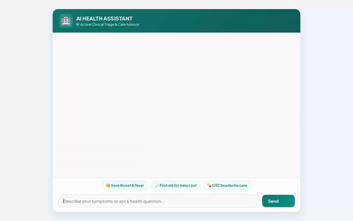

# 🏥 AI Health Assistant (`health-triage-agent`)

> A conversational health triage agent built with the Google Agent Development Kit (ADK) and `agents-cli`. It evaluates user symptoms, checks medical history and allergies across sessions, provides OTC medication & first-aid guidance from Firestore, generates visual medical diagrams & demonstration videos on demand, and renders structured A2UI cards.



---

## 🌟 Key Features & Capabilities

The capabilities listed below are implemented in `app/agent.py` and supported by Google Cloud services:

* 🩺 **Clinical Symptom Triage & Specialist Guidance:** Evaluates reported symptoms, flags emergency warning signs, suggests potential health conditions, and recommends doctor specialist domains (e.g., ENT Specialist, Cardiologist, Dermatologist, Gastroenterologist).
* 🧠 **Cross-Session Patient Memory (Vertex AI Memory Bank):** Automatically persists and recalls patient medical history, chronic conditions, and allergies (e.g., Penicillin, NSAIDs, Aspirin, Latex) across chat sessions using `VertexAiMemoryBankService`.
* 💊 **OTC Medication & First-Aid Catalog (Firestore):** Queries a Firestore database (`first_aid_catalog` collection) for verified OTC medication dosage guidelines, contraindications, and step-by-step first-aid care procedures.
* 🖼️ **First-Aid Diagram Image Generation (Vertex AI Imagen / Gemini):** Uses `gemini-3.1-flash-lite-image` in the `global` region to generate educational first-aid reference diagrams, saved to Playground Artifacts and stored in a public **Google Cloud Storage** bucket.
* 📹 **First-Aid Demonstration Video Generation (Google Omni Model):** Uses `gemini-omni-flash-preview` in the `global` region to generate short educational demonstration videos, saved to Playground Artifacts (`tool_context.save_artifact`) and uploaded to public **Google Cloud Storage**.
* 🏥 **Nearby Healthcare Facility Search (Google Maps & Places):** Geocodes user locations and searches for nearby urgent care centers, clinics, and pharmacies.
* 🧮 **Health Metric & Dosage Code Execution (Agent Engine Sandbox):** Executes Python code in a secure Agent Engine Sandbox to perform health metric calculations (e.g., BMI, pediatric dosage by weight).
* 🎨 **Agent-First UI (A2UI v0.8):** Emits structured A2UI cards (Card, Column, Text, Image) rendered natively in the custom web chat interface.

---

## 🏗️ Architecture & Wired Google Cloud Services

| Component | Technology / Service | Implementation File |
| --- | --- | --- |
| **Agent Framework** | ADK (Agent Development Kit) & `agents-cli` v1.1.0 | [`app/agent.py`](app/agent.py) |
| **Long-Term Memory** | Vertex AI Memory Bank Service | `VertexAiMemoryBankService` in [`app/agent.py`](app/agent.py) |
| **Structured Database** | Google Cloud Firestore | `first_aid_catalog` collection in [`app/agent.py`](app/agent.py) |
| **Asset Storage** | Google Cloud Storage (GCS) | `qwiklabs-gcp-01-1261bf882821-health-triage-assets` in [`app/agent.py`](app/agent.py) |
| **Image Generation** | `gemini-3.1-flash-lite-image` (Vertex AI, global) | `generate_first_aid_visual` tool |
| **Video Generation** | `gemini-omni-flash-preview` (Vertex AI, global) | `generate_first_aid_video` tool |
| **Code Sandbox** | Agent Engine Sandbox Code Executor | `AgentEngineSandboxCodeExecutor` |
| **Rich Card UI** | A2UI (BasicCatalog v0.8) | `a2ui_callback` in [`app/a2ui_utils.py`](app/a2ui_utils.py) |
| **Web Frontend** | FastAPI proxy + Hospital Teal HTML/CSS Chat UI | [`frontend/main.py`](frontend/main.py) & [`frontend/static/index.html`](frontend/static/index.html) |

---

## 🛠️ Project Structure

```text
health-triage-agent/
├── app/
│   ├── agent.py               # Main ADK agent logic & tool definitions
│   ├── a2ui_utils.py          # A2UI response formatting callback
│   └── __init__.py
├── frontend/
│   ├── main.py                # FastAPI proxy server (A2A protocol)
│   ├── requirements.txt       # Frontend dependencies (FastAPI, uvicorn, google-genai)
│   └── static/
│       └── index.html         # Dialogue chat UI with A2UI card renderer
├── agents-cli-manifest.yaml   # Deployment & framework manifest
├── deployment_metadata.json   # Remote Agent Engine reasoning engine resource ID
├── health_triage_agent_demo.gif  # Inline demo recording
├── health_triage_agent_demo.webm # Raw Playwright screen recording
└── README.md
```

---

## 🚀 How to Run Locally

### Prerequisites

* Python 3.11+
* Authenticated Google Cloud credentials:
  ```bash
  gcloud auth login
  gcloud auth application-default login
  ```

### 1. Run in ADK Playground

To test the agent using the ADK dev environment:

```bash
agents-cli playground
```

### 2. Run the Custom Web Frontend Locally

1. Install frontend dependencies:
   ```bash
   cd frontend
   pip install -r requirements.txt
   ```

2. Set environment variables using your deployed reasoning engine resource name:
   ```bash
   export AGENT_ENGINE_RESOURCE_NAME="projects/<PROJECT_ID>/locations/<LOCATION>/reasoningEngines/<REASONING_ENGINE_ID>"
   export AGENT_DIRECTORY="app"
   ```

3. Start the FastAPI local server:
   ```bash
   python main.py
   ```

4. Open your web browser to the local server address (default port `8080`) to interact with the **AI Health Assistant**.

---

## ☁️ Deployment

To deploy the agent runtime and custom frontend to Google Cloud:

```bash
# Deploy agent runtime to Vertex AI Reasoning Engine
agents-cli deploy

# Deploy custom frontend to Cloud Run
cd frontend
gcloud run deploy health-triage-frontend \
  --source . \
  --region us-east1 \
  --allow-unauthenticated \
  --set-env-vars AGENT_ENGINE_RESOURCE_NAME="<REASONING_ENGINE_RESOURCE_NAME>",AGENT_DIRECTORY="app"
```
